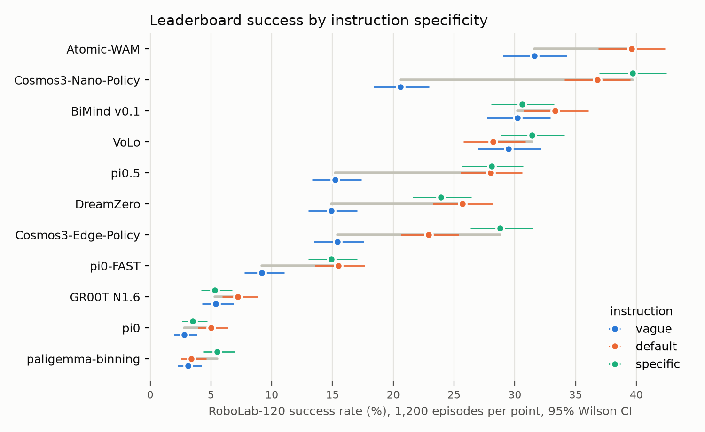

# RoboLab: preliminary analysis without simulation (2026-10-21)

What we can say about RoboLab-120 and its leaderboard before running anything. No rollouts: the
numbers come from the published leaderboard JSON (v55, copied to `leaderboard_v55.json`), the
RoboLab source at `NVlabs/RoboLab@b6cfcf6` (task metadata, scene USDA files, DROID corpus file), and a
pinhole projection of the scenes into the policy camera. Reproduce with

```bash
uv run --no-project --with matplotlib python robolab_lang/prelim_analysis.py --robolab <RoboLab checkout> --leaderboard docs/robolab/leaderboard_v55.json --figdir docs/robolab/figures
```

Design and next steps are in [`plan.md`](plan.md). The two servers we planned to use (`berkeley`,
`berkeley-2`) were gone on 2026-10-21, so the pilot has not started.

## Findings

| # | Finding | Evidence | Strength |
|--:|---|---|---|
| R1 | **The leaderboard number hides a language axis.** It ranks on `default` only. Going from `default` to `vague` costs π0.5 12.8 pts (28.0 → 15.2), Cosmos3-Nano 16.2, DreamZero 10.7, Atomic-WAM 8.0; all four are well outside the ±3–4 pt CI of the difference. | §A table and figure | Strong (1,200 episodes per cell) |
| R2 | **The two models whose drop vanishes are the ones with extra machinery or in-domain data**: VoLo (an agent wrapped around π0.5) −1.3 ± 3.6 and BiMind (RoboLab data in training and fine-tuning) +3.1 ± 3.7. VoLo vs plain π0.5 is the closest controlled contrast on the board: same policy, vague SR 29.5 vs 15.2. | §A; training flags in leaderboard JSON | Moderate (observational; two models) |
| R3 | **More words do not help.** `specific` − `default` is within ±3 pts for 8 of the 10 models that report both (π0.5 +0.1); only Cosmos3-Edge (+5.9) and VoLo (+3.2) gain. The models are not short of detail; they lose when the instruction names a category instead of an object. | §A | Strong for "no gain"; cause not tested |
| R4 | **The vague drop is not out-of-vocabulary wording.** `vague` instructions use *fewer* words absent from DROID (8.7% of content words, 27 of 120 tasks) than `default` (14.6%, 51 tasks), yet score lower. What `vague` removes is the object name ("Put away the animals", "Put the fruit in the bowl"), so the failure is category → instance grounding, not lexical distance. This refines LIBERO's H6 / P4 for these models. | §B | Moderate (corpus counts over distinct strings; no per-task SR is public to correlate) |
| R5 | **Exclusion is barely tested by RoboLab-120 and absent from DROID.** Three tasks carry an exclusion in their instruction (`CleanUpToys`, `NonHammerToolsInRightBin`, `ToolOrganizationBoth`); the DROID corpus has "not" in 3 of 31,307 strings and "except" in 9. LIBERO's negation finding (H1) is therefore untested on this board and a zero-shot test for every DROID-trained model. | §B; `plan.md` §4.3 | Strong as a coverage fact |
| R6 | **Only two RoboLab-120 pairs are clean language tests** (identical objects, only the sentence picks the target): `MustardIn{Left,Right}Bin` and `BowlStacking{LeftOnRight,RightOnLeft}`. 104 of 120 tasks share their scene with another task, but the shared-scene tasks differ in which *different-looking* object is the goal. | §C; `plan.md` §3.1 | Strong (from task files and USDA) |
| R7 | **One of the two clean pairs is not left/right in the image the policy sees.** In `over_shoulder_left_camera` the two bowls of `BowlStacking*` sit in the same image column (Δu −0.6 px of 224) and differ only in height; "left bowl" is the *lower* bowl. Bins in the other scenes are consistent (robot-left bin drawn 38–52 px to the image left). "Left of" and "behind" goals both point to the image left, separated only vertically. | §D | Strong for geometry (pinhole projection; to be confirmed on one render) |
| R8 | **Possible benchmark inconsistency in `FoodPackingByColorTask`.** The instruction says yellow → right container, blue → left. The success term puts `coffee_can` in `bin_a06` (robot-left) and `mustard` + `sugar_box` in `bin_b03` (robot-right), consistent with the text if the coffee can is the blue object; the subtask (partial-credit) terms are the reverse (`mustard` → `bin_a06`, `coffee_can` → `bin_b03`). The `specific` text names only "the yellow can", while success needs both `mustard` and `sugar_box` in the right container. | `robolab/tasks/benchmark/food_packing_by_color_task.py` | To verify: object colours need one render; report upstream only after that |

## A. Leaderboard success by instruction variant



Eleven of the 17 board entries report more than one variant. Wilson 95% CIs in brackets; the
difference CI is a normal approximation for two independent sets of 1,200 episodes on the same 120
tasks.

| Policy | vague | default | specific | default − vague (95% CI) | specific − default |
|---|---|---|---|---|---|
| Atomic-WAM | 31.6 [29.0, 34.3] | 39.6 [36.9, 42.4] | — | +8.0 ± 3.8 | — |
| Cosmos3-Nano-Policy | 20.6 [18.4, 23.0] | 36.8 [34.1, 39.5] | 39.7 [36.9, 42.5] | +16.2 ± 3.6 | +2.9 |
| BiMind v0.1 | 30.2 [27.7, 32.9] | 33.3 [30.7, 36.1] | 30.6 [28.0, 33.2] | +3.1 ± 3.7 | −2.7 |
| VoLo | 29.5 [27.0, 32.1] | 28.2 [25.8, 30.9] | 31.4 [28.9, 34.1] | −1.3 ± 3.6 | +3.2 |
| π0.5 | 15.2 [13.3, 17.4] | 28.0 [25.5, 30.6] | 28.1 [25.6, 30.7] | +12.8 ± 3.3 | +0.1 |
| DreamZero | 14.9 [13.0, 17.0] | 25.7 [23.3, 28.2] | 23.9 [21.6, 26.4] | +10.7 ± 3.2 | −1.8 |
| Cosmos3-Edge-Policy | 15.4 [13.5, 17.6] | 22.9 [20.6, 25.4] | 28.8 [26.3, 31.5] | +7.5 ± 3.1 | +5.9 |
| π0-FAST | 9.2 [7.7, 11.0] | 15.5 [13.6, 17.7] | 14.9 [13.0, 17.0] | +6.2 ± 2.6 | −0.6 |
| GR00T N1.6 | 5.4 [4.3, 6.8] | 7.2 [5.9, 8.9] | 5.3 [4.2, 6.8] | +1.8 ± 1.9 | −1.9 |
| π0 | 2.8 [2.0, 3.8] | 5.0 [3.9, 6.4] | 3.5 [2.6, 4.7] | +2.3 ± 1.5 | −1.5 |
| paligemma-binning | 3.1 [2.2, 4.2] | 3.4 [2.5, 4.6] | 5.5 [4.3, 6.9] | +0.3 ± 1.4 | +2.1 |

Drop by competency axis (`default` − `vague`, pts; axes overlap because tasks carry several tags):

| Policy | visual | relational | procedural |
|---|---|---|---|
| Atomic-WAM | +7.7 | +6.4 | +10.0 |
| Cosmos3-Nano-Policy | +12.6 | +16.9 | +13.7 |
| BiMind v0.1 | +4.9 | −1.0 | +5.5 |
| VoLo | −1.1 | +0.7 | −1.8 |
| π0.5 | +11.5 | +9.8 | +10.9 |
| DreamZero | +8.0 | +14.3 | +10.5 |
| Cosmos3-Edge-Policy | +5.3 | +3.4 | +3.2 |
| π0-FAST | +3.6 | +4.5 | +3.2 |
| GR00T N1.6 | +0.7 | +5.2 | −1.4 |
| π0 | +1.1 | +0.2 | −0.9 |
| paligemma-binning | −0.9 | +0.0 | −0.4 |

The drop is spread over all three axes rather than concentrated in one, consistent with R4 (the vague
text removes the object name whatever the task type). Models below about 10% `default` SR show no
measurable drop; that is a floor, not robustness.

Limits: per-task results are not public, so neither the drop per task nor its relation to scene layout
can be computed from the board. Episodes per task are 10; the paper itself warns that per-task numbers
at n = 10 are coarse (±30 pts near 50%).

## B. Instruction wording vs. the DROID corpus

DROID corpus: 31,307 distinct task strings (RoboLab's `analysis/droid_dataset/tasks.jsonl`), 1,957
word types. A word counts as absent if no DROID string contains it.

| Variant | mean share of content words absent from DROID | tasks with ≥ 1 absent word | most frequent absent words |
|---|---|---|---|
| vague | 8.7% | 27 / 120 | hammers, bagels, pail, drill, cartons, bbq, raisin, birdhouse |
| default | 14.6% | 51 / 120 | rubiks, foods, boxed, cartons, bbq, raisin, dishware, onion |
| specific | 14.2% | 85 / 120 | rubiks, identify, grasp, raisin, robot, tipped, lizard, bagels |

Instructions with an exclusion: `CleanUpToysTask` (vague "Clean up everything except the birdhouse";
default "…and leave the birdhouse on the table"), `NonHammerToolsInRightBinTask` (default and vague,
"non-hammer"), `ToolOrganizationBothTask` (default "…and do not touch anything else"), plus two
`specific` texts with a conditional "leave it if already upright".

## C. Scene sharing

47 scenes serve 120 tasks; 31 scenes host 2–7 tasks (104 tasks), 16 tasks have their own scene. A
policy that ignores the sentence and does one fixed thing per scene can solve at most the goals that
thing happens to satisfy, so shared scenes are where language must matter, but only the two pairs in
R6 hold everything except the sentence fixed.

## D. Left/right words against the policy camera

The π-family client feeds `over_shoulder_left_camera` (mounted at the robot's left, looking
right-and-down), letterboxed from 1280×720 to 224×224. Δu > 0: the robot-left object is drawn to the
image left; Δv > 0: drawn lower.

| Task(s) | robot-left object (y, m) | robot-right object (y, m) | Δu (px) | Δv (px) | image reading |
|---|---|---|---|---|---|
| `MustardIn{Left,Right}BinTask` | `grey_bin_left` (+0.29) | `grey_bin_right` (−0.29) | +37.8 | +22.2 | consistent |
| `BowlStacking{LeftOnRight,RightOnLeft}Task` | `bowl_2` (+0.00) | `bowl_1` (−0.19) | −0.6 | +15.1 | **no horizontal separation** |
| `ClampInRightBin`, `HammersInLeftBin`, `NonHammerTools…`, `ToolOrganization*` | `left_bin` (+0.38) | `right_bin` (−0.31) | +47.0 | +24.8 | consistent |
| `FoodPackingByColorTask` | `bin_a06` (+0.37) | `bin_b03` (−0.40) | +52.1 | +21.5 | consistent |

Goal relations, 10 cm from the bowl in the robot-frame direction RoboLab's predicate uses (left = +y,
behind = +x):

| Task | relation | image direction of the goal (Δu, Δv px) |
|---|---|---|
| `RubiksCubeLeftOfBowlTask` | left of | (−8.3, +5.0): image left and down |
| `RubiksCubeBehindBowlTask` | behind | (−7.0, −5.6): image left and up |
| `RubiksCubeInFrontOfBowlTask` | in front of | (+8.1, +6.5): image right and down |
| `RubiksCubeRightOfBowlTask` | right of | (+5.0, −3.4): image right and up |

The camera looks diagonally across the table, so each robot-frame direction maps to an image diagonal;
"left of" and "behind" share the image-left half. Whether DROID annotators meant robot, camera or their
own left is not recorded.

## What this does not show

- Nothing here measures which object a policy moved; that needs rollouts with the outcome logging in
  `plan.md` §3.3.
- R2 compares different systems, not one model with and without a component.
- R7's geometry is a pinhole projection from scene files; one render must confirm it before it is
  cited as a result.
